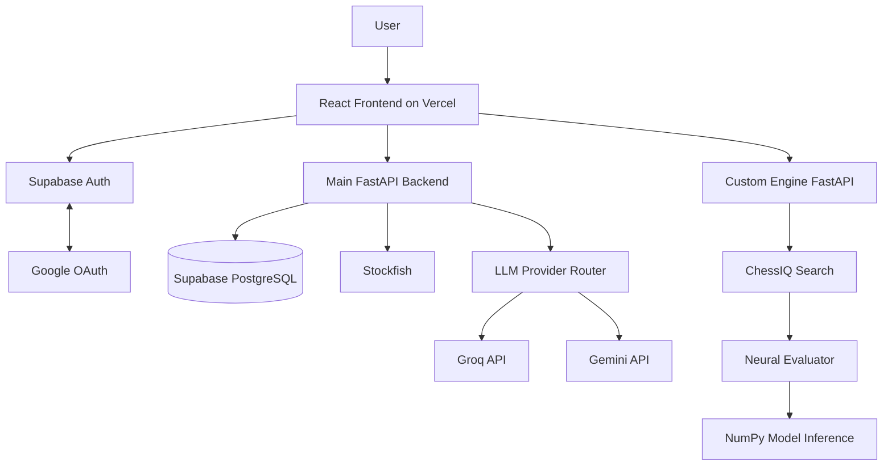
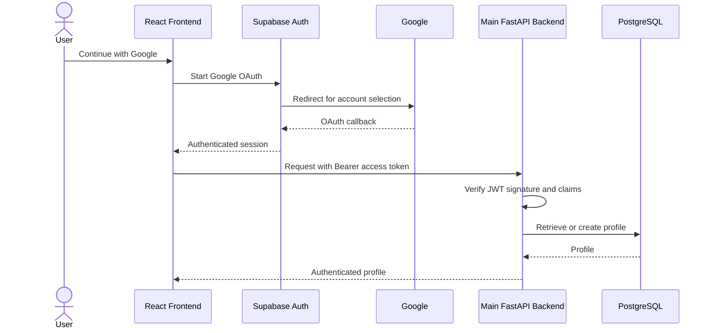

<div align="center">

# ♟️ CHESS-IQ

### AI-powered chess analysis, play and coaching, built around a custom neural engine

[](https://chessiq-hazel.vercel.app/)
[](https://react.dev/)
[](https://www.typescriptlang.org/)
[](https://fastapi.tiangolo.com/)
[](https://pytorch.org/)
[](https://supabase.com/)
[](LICENSE)

[**Live Application**](https://chessiq-hazel.vercel.app/)

</div>

---

## Table of Contents

1. [Overview](#1-overview)
2. [Features](#2-features)
3. [Architecture](#3-architecture)
4. [Repository Structure](#4-repository-structure)
5. [Frontend](#5-frontend)
6. [Authentication](#6-authentication)
7. [Main Backend and Database](#7-main-backend-and-database)
8. [Stockfish and the AI Coach](#8-stockfish-and-the-ai-coach)
9. [The Custom CHESS-IQ Engine](#9-the-custom-chess-iq-engine)
10. [Getting Started](#10-getting-started)
11. [Configuration](#11-configuration)
12. [Testing](#12-testing)
13. [Deployment](#13-deployment)
14. [Limitations](#14-limitations)
15. [License and Acknowledgements](#15-license-and-acknowledgements)

---

## 1. Overview

CHESS-IQ lets players **play, analyze, solve puzzles, explore openings and understand their mistakes** through an AI coach. Its central engineering piece is a **custom chess engine**: we designed the position encoder, trained and compared six neural-network configurations, implemented minimax search with alpha-beta pruning, and serve it through its own API.

| Component | Stack | Responsibility |
|---|---|---|
| **Frontend** | React, TypeScript, Vite | Interface, chessboard, routing, auth state, API clients |
| **Main backend** | Python, FastAPI | Accounts, games, puzzles, Stockfish analysis, AI Coach |
| **Custom engine** | Python, FastAPI, NumPy | Neural evaluation, search, move selection |

Supporting services: Supabase (Auth and PostgreSQL), Google OAuth, Groq and Gemini APIs, and Stockfish.

> **Two different engines.** Stockfish powers conventional analysis and browser play. The custom CHESS-IQ engine uses our own neural evaluator and search, and never calls Stockfish to choose a move.

## 2. Features

| Route | Feature |
|---|---|
| `/play` | Play Stockfish (WebAssembly) at six difficulty levels, by depth or move time |
| `/play-coach` | Play against the **custom CHESS-IQ engine** |
| `/analysis` | Engine evaluation, best lines, game review |
| `/coach` | Chat with the AI Coach, grounded in Stockfish facts |
| `/puzzles` | Puzzles imported from the Lichess database, with attempt tracking |
| `/openings` | Browse and train openings |
| `/profile` | Google sign-in, saved games and statistics |

## 3. Architecture

The frontend talks to the main backend and the custom engine through **separate API clients**. It uses Supabase directly only for authentication, and never touches PostgreSQL or holds LLM credentials.



## 4. Repository Structure

```text
chessiq/
├── src/                    # React frontend
│   ├── pages/              # One file per route
│   ├── components/         # ChessBoard, EvalBar, MoveList, ...
│   ├── hooks/              # useStockfish, useChessIq
│   ├── engine/             # Stockfish wrapper, difficulty config
│   ├── store/              # Auth provider, Zustand store
│   └── lib/                # API clients, Supabase, chess/PGN helpers
├── public/stockfish/       # Stockfish WebAssembly build (GPL-3.0)
├── backend/                # Main FastAPI service
│   ├── app/                # Routes, auth, db, Stockfish, prompts, llm/
│   ├── sql/schema.sql      # Tables, triggers, Row Level Security
│   └── tests/
├── chessengine/            # Custom engine
│   ├── src/                # Features, model, training, engine/{search,evaluator,uci}
│   ├── api/                # FastAPI service, NumPy evaluator, weight export
│   ├── checkpoints/        # model_d_square.pth and .npz
│   └── demo/               # Tkinter demo
├── scripts/                # Lichess puzzle importer, Stockfish copy script
└── vercel.json             # SPA rewrite
```

## 5. Frontend

**React 18, TypeScript 5, Vite 5, Tailwind CSS 3, React Router 6, Zustand 5, Supabase JS, chess.js, Stockfish 19 (WebAssembly), Framer Motion and Recharts.**

- `src/lib/api.ts` talks to the main backend (profiles, games, stats, puzzles, coaching).
- `src/lib/engineApi.ts` talks to the custom engine (health checks, move requests).
- `src/main.tsx` mounts the app inside `BrowserRouter` and `AuthProvider`. The auth provider holds the Supabase session, user, profile and loading state; Zustand holds everything else.
- In development, Vite proxies `/api` to `http://localhost:8000`.

## 6. Authentication

Authentication uses **Supabase Auth with Google OAuth**. We do not implement Google's protocol ourselves: the frontend calls `signInWithOAuth`, and Supabase handles the redirect, callback and token exchange.



- **Client** (`src/lib/supabase.ts`): session persistence, automatic token refresh and callback detection. OAuth returns users to `/profile`.
- **Server** (`backend/app/auth.py`): independently verifies signature, expiry, subject, audience, role and algorithm. Supports HS256 and asymmetric verification via Supabase JWKS (ES256, RS256, EdDSA). The user ID comes from the verified `sub` claim, never from the browser.
- **Dependencies:** `optional_user` allows anonymous access while still validating any supplied token; `current_user` requires authentication.
- **Profiles:** identities live in `auth.users`; app data lives in `public.profiles`. A database trigger creates the profile, and `ensure_profile()` is a backend safeguard.
- **Secrets:** the frontend holds only the public Supabase URL and anon key. Service-role keys and other secrets stay in backend environment variables.

## 7. Main Backend and Database

A **Python 3.11 FastAPI** app served by Uvicorn, using Pydantic 2, psycopg 3 with psycopg-pool (1 to 8 connections), PyJWT, HTTPX and python-chess. The pool and Stockfish processes are opened at startup and closed at shutdown.

| Module | Responsibility |
|---|---|
| `main.py` | App setup, lifecycle, middleware, route registration |
| `auth.py` | Supabase JWT verification |
| `config.py` / `db.py` | Environment config and connection pool |
| `engine.py` | Stockfish process management |
| `analysis.py` | Analysis and game-review facts |
| `prompts.py` | Coach prompt construction |
| `routes_account.py` | Profiles, saved games, statistics |
| `routes_puzzles.py` | Puzzle retrieval and attempts |
| `routes_coach.py` | Coach conversations and streamed responses |
| `llm/` | Provider abstraction, router, Groq and Gemini clients |

**API surface**

| Area | Endpoints |
|---|---|
| Health | `GET /api/health` |
| Account | `GET/PATCH /me`, `GET /me/stats`, `POST/GET /games`, `GET/DELETE /games/{id}` |
| Puzzles | `GET /next`, `/daily`, `/themes`, `/{id}`; `POST /{id}/attempts` |
| Coach | `POST /chat` (SSE), `GET/POST /conversations`, `GET /conversations/{id}/messages`, `DELETE /conversations/{id}` |

**Database** (Supabase PostgreSQL, schema in `backend/sql/schema.sql`): `profiles`, `games` (PGN and optional analysis), `puzzles`, `puzzle_attempts`, `conversations`, `messages` (content, chess facts, provider metadata). **Row Level Security is enabled**: user-owned records are restricted to their owner, while puzzles are publicly readable.

## 8. Stockfish and the AI Coach

**Stockfish.** The browser runs Stockfish 19 WebAssembly for play. The backend launches Stockfish over UCI through `python-chess`, with **separate long-lived instances** for interactive analysis and background game reviews, so a long review never blocks a live request. Access to each process is synchronized.

**AI Coach.** The coach does not ask an LLM to calculate a position. It combines engine facts with language generation:

1. The backend gathers context: FEN, selected move, PGN, player information.
2. Stockfish produces structured facts: evaluation, best move, continuation, move quality.
3. The facts go into a prompt sent to the configured LLM provider.
4. The model turns the analysis into a plain-language explanation.

If Stockfish is unavailable, the backend says so instead of fabricating analysis.

| Provider | Model | Role |
|---|---|---|
| Groq | `llama-3.3-70b-versatile` | Primary |
| Gemini | `gemini-2.5-flash` | Fallback |

The order is set by `LLM_PROVIDER_ORDER` (default `groq,gemini`). The router in `llm/router.py` checks configuration and cooldown and can fall back if a provider fails **before producing output**. It never splices a second provider into a stream already in progress.

Responses stream over **Server-Sent Events** with event types `analysis`, `meta`, `token`, `warning`, `error` and `done`. Authenticated conversations are persisted with role, content, chess facts and provider metadata.

## 9. The Custom CHESS-IQ Engine

An independent Python service in `chessengine/`: **position encoding → neural evaluation → search → API response.** Training uses PyTorch; production inference uses NumPy.

### 9.1 Position encoding

`src/features.py` encodes each position from both players' perspectives: `(2, 1024)`, flattened to **2,048 inputs**.

| Feature group | Per perspective |
|---|---:|
| 12 piece types × 64 squares | 768 |
| Castling rights | 4 |
| En passant square (one-hot) | 64 |
| Side to move | 1 |
| Halfmove clock (÷100, clipped) | 1 |
| Reserved, zero-filled | 186 |
| **Total** | **1,024** |

Piece-square features are binary with relative ownership channels. Black's perspective flips ranks with `square ^ 56`. The 186 reserved slots allow new features without changing the input size.

### 9.2 Network: D-Square

We tested six configurations and chose **D-Square**, a compact feed-forward, NNUE-inspired network. It is our own implementation and is **not** identical to Stockfish's NNUE.

```text
2048 ─ Linear → 128 ─ Squared Clipped ReLU
     ─ Linear → 64  ─ Clipped ReLU
     ─ Linear → 32  ─ Clipped ReLU
     ─ Linear → 1   ─ evaluation (pawns)
```

**272,641 trainable parameters**: `(2048×128+128) + (128×64+64) + (64×32+32) + (32×1+1)`. Clipped ReLU is `clamp(x, 0, 1)`; Squared Clipped ReLU is `clamp(x, 0, 1)²`.

### 9.3 Architecture experiments

| Model | Architecture | Val. MAE ↓ | Corr. ↑ |
|---|---|---:|---:|
| A | 2048 → 8 → 32 → 1 | 1.7330 | 0.7747 |
| B | 2048 → 32 → 32 → 1 | 1.6600 | 0.7927 |
| C | 2048 → 64 → 32 → 1 | 1.6098 | 0.8030 |
| C-Extended | 2048 → 64 → 32 → 1 | 1.5104 | 0.8180 |
| D | 2048 → 128 → 64 → 32 → 1 | 1.4639 | 0.8223 |
| **D-Square** | 2048 → 128 → 64 → 32 → 1 | **1.4585** | **0.8236** |

MAE is average absolute error in pawns. These measure **evaluation accuracy, not playing strength**, and no Elo has been established for the engine.

### 9.4 Dataset

PGN games are converted to labelled positions with python-chess (reconstruct positions, extract FENs, drop terminal positions, deduplicate). Extraction sampled **200,000 of ~4,193,152 games** (seed 42), skipping the first 20 plies and taking every 8th.

| Positions | Count |
|---|---:|
| Extracted | 1,465,040 |
| Centipawn-evaluated | 1,441,705 |
| Mate-evaluated (excluded from regression) | 23,335 |
| **Training / Validation** | **1,296,470 / 145,235** |

Targets are centipawns ÷ 100. The split is **by game ID** to limit leakage between positions of one game. Features are stored as memory-mapped `(N, 2, 1024)` arrays.

### 9.5 Training

PyTorch with AdamW, Smooth L1 loss, ReduceLROnPlateau and early stopping; CUDA when available, otherwise CPU.

Learning rate 0.001, weight decay 0.00001, batch size 1,024, up to 20 epochs, early-stopping patience 4, scheduler patience 2 (factor 0.5, minimum LR 0.000001), seed 42.

### 9.6 Search

The network scores positions; `ChessIQSearch` (`src/engine/search.py`) chooses moves.

- **Minimax** with **alpha-beta pruning**
- **Iterative deepening**, keeping the best completed result
- **Quiescence search** over captures, promotions and check evasions (max depth 12)
- **Move ordering** by victim/attacker value, promotions and the transposition-table move
- **Transposition table** keyed by FEN, with `EXACT`, `LOWER` and `UPPER` bounds
- **Terminal handling** with mate score 10,000, adjusted by ply to prefer faster wins and slower losses

`python-chess` supplies the rules layer (board, FEN, legal moves, check/mate and draw detection, SAN/UCI). So this is a **custom evaluator and search built on an established rules library**, not a from-scratch reimplementation of every engine component.

### 9.7 UCI interface

`src/engine/uci.py` implements `uci`, `isready`, `ucinewgame`, `position startpos|fen`, `go depth`, `stop` and `quit`, so the engine can be tested without the web app or used in compatible GUIs. A Tkinter demo is in `chessengine/demo/`.

### 9.8 PyTorch to NumPy inference

Production avoids installing PyTorch. The model is exported to `model_d_square.npz` (`w0`/`b0` … `w3`/`b3`), and a NumPy evaluator reproduces the four layers and both activations.

### 9.9 Engine API

| Endpoint | Purpose |
|---|---|
| `GET /api/health` | Model status and limits (HTTP 503 if the model is not loaded) |
| `POST /api/engine/move` | Send `fen`, or `start_fen` + UCI `moves`, plus optional `depth` |

The response includes `best_move`, `san`, the new `fen`, `depth`, `nodes`, `tt_hits`, `elapsed_ms`, a white-perspective `score` and game `status`. Sending the full move list lets threefold repetition and the fifty-move rule be detected. Being CPU-bound, the service caps depth (default 3, max 4), limits concurrent searches, queues extras and rate-limits per IP.

## 10. Getting Started

**Prerequisites:** Node.js 18+, Python 3.11, a Supabase project, and optionally Stockfish (`apt install stockfish`) plus Groq/Gemini API keys for the coach.

```bash
git clone https://github.com/Sarthak3846/chessiq.git && cd chessiq
```

**1. Frontend** (http://localhost:5173)
```bash
cp .env.example .env.local      # fill in the Supabase values
npm install                     # also copies the Stockfish WASM build
npm run dev
```

**2. Main backend** (http://localhost:8000)
```bash
cd backend
cp .env.example .env            # fill in Supabase, DATABASE_URL, LLM keys
pip install -r requirements.txt
psql "$DATABASE_URL" -f sql/schema.sql
uvicorn app.main:app --reload --port 8000
```

**3. Custom engine** (http://localhost:8001)
```bash
cd chessengine
cp .env.example .env
pip install -r requirements-api-lite.txt
uvicorn api.main:app --reload --port 8001
```

**Optional**
```bash
python -m src.engine.uci                  # UCI mode (from chessengine/)
python -m api.export_numpy_weights        # regenerate .npz from the .pth checkpoint
pip install zstandard && python scripts/import_lichess_puzzles.py --limit 40000   # import puzzles
```

## 11. Configuration

<details>
<summary><b>Frontend</b> (<code>.env.local</code>, only <code>VITE_*</code> is exposed to the browser)</summary>

| Variable | Purpose |
|---|---|
| `VITE_API_BASE_URL` | Main backend URL. Leave empty in dev to use the Vite proxy |
| `VITE_ENGINE_API_URL` | Custom engine URL (default `http://localhost:8001`) |
| `VITE_SUPABASE_URL` / `VITE_SUPABASE_ANON_KEY` | Public Supabase settings |

</details>

<details>
<summary><b>Main backend</b> (<code>backend/.env</code>, never commit)</summary>

| Variable | Purpose |
|---|---|
| `LLM_PROVIDER_ORDER` | Provider fallback order (`groq,gemini`) |
| `GROQ_API_KEY` / `GROQ_MODEL` | Groq credentials and model |
| `GEMINI_API_KEY` / `GEMINI_MODEL` | Gemini credentials and model |
| `STOCKFISH_PATH` / `STOCKFISH_MOVETIME` | Binary path and seconds per analysis |
| `SUPABASE_URL` | Used for JWKS verification |
| `SUPABASE_JWT_SECRET` | Only for legacy HS256 projects |
| `DATABASE_URL` | PostgreSQL connection string |
| `CORS_ORIGINS` / `RATE_LIMIT_PER_MIN` | Allowed origins and rate limit (default 20) |

</details>

<details>
<summary><b>Custom engine</b> (<code>chessengine/.env</code>, no secrets)</summary>

| Variable | Purpose |
|---|---|
| `ENGINE_RUNTIME` | `auto`, `numpy` or `torch` |
| `ENGINE_WEIGHTS_NPZ` / `ENGINE_CHECKPOINT` | Weight file paths |
| `ENGINE_DEFAULT_DEPTH` / `ENGINE_MAX_DEPTH` | Search depth (3 / 4) |
| `ENGINE_MAX_CONCURRENT` / `ENGINE_MAX_QUEUE` | Concurrent and queued searches |
| `ENGINE_REQUEST_TIMEOUT` | Seconds before a search times out |
| `ENGINE_RATE_LIMIT_PER_MIN` | Per-IP rate limit |
| `CORS_ORIGINS` / `CORS_ORIGIN_REGEX` | Allowed browser origins |

</details>

## 12. Testing

```bash
cd backend && pytest        # needs a local Postgres and Stockfish (see tests/conftest.py)
cd chessengine && pytest    # engine API: legality, mate, draws, validation, concurrency, CORS
```

Backend tests cover auth, JWKS, per-user isolation, Row Level Security, puzzle import, LLM fallback and coach streaming. Engine tests cover mates, draws, illegal input, depth limits and determinism.

## 13. Deployment

| Service | Target |
|---|---|
| Frontend | Vercel (SPA rewrite in `vercel.json`; set the `VITE_*` variables) |
| Main backend | Docker (`backend/Dockerfile`, installs Stockfish, non-root) |
| Custom engine | Docker (`chessengine/Dockerfile`, PyTorch-free NumPy runtime, non-root) |

Both read `$PORT` and run Uvicorn with proxy headers. Production URLs are set through environment variables.

## 14. Limitations

- No Elo rating has been established for the custom engine; validation MAE and correlation measure evaluation accuracy only.
- The engine is pure Python, so search depth is capped for responsiveness.
- The opening library is bundled static data, not database-backed.

## 15. License and Acknowledgements

Released under the [MIT License](LICENSE).

Built with [python-chess](https://python-chess.readthedocs.io/), [Stockfish](https://stockfishchess.org/) (GPL-3.0, bundled WASM build), the [Lichess puzzle database](https://database.lichess.org/#puzzles) (CC0), [Supabase](https://supabase.com/), [Groq](https://groq.com/) and [Google Gemini](https://ai.google.dev/).
